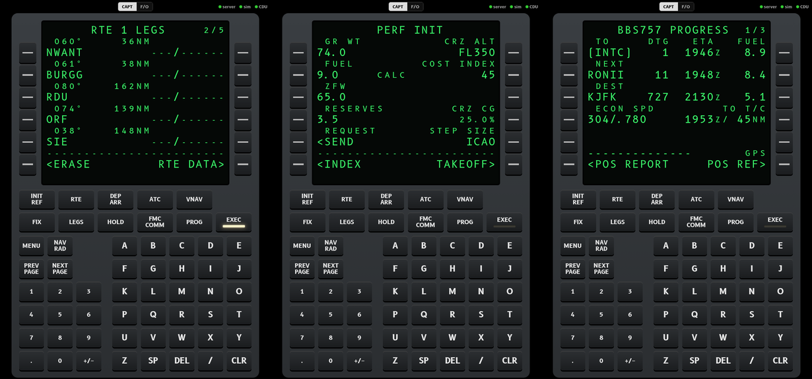

# bbs757-webcdu

The **BlueBird Simulations 757** CDU in your browser. You get the live screen, every key and
the EXEC light on a tablet, phone or second monitor, for Microsoft Flight Simulator.

KATL → KJFK via PLMMR3 and CAMRN5, entered entirely from the web CDU.
Left: the route edit waiting to be executed, with EXEC lit.

## Features

- Full CDU: the screen, every key, and the EXEC light
- Captain and First Officer CDUs, switchable at the top of the page
- Works in any modern browser on the same network, with no app to install on the tablet
- One small `.exe` on the sim PC with everything built in

## Getting started

1. Download `bbs757-webcdu.exe` from [Releases](../../releases).
2. Close MobiFlight if it's running, because both use port 8320.
3. Start `bbs757-webcdu.exe` on the sim PC, then load the 757. A console window opens; **keep
   it open while you fly**.
4. On your tablet, phone or second PC, open the address shown in the window.
   **Add to Home Screen** in the browser menu gets it full-screen.

The first time, Windows may ask whether to allow the app through the firewall. Allow it on
private networks, or the tablet can't connect. The `.exe` isn't code-signed, so SmartScreen
may warn you on first launch. Choose **More info → Run anyway**.

## Status lights

| dot    | green means                                                               |
|--------|---------------------------------------------------------------------------|
| server | the page is connected to the app                                          |
| sim    | the app is connected to MSFS through SimConnect (needed for key presses)  |
| CDU    | the 757 is sending this seat's screen (CAPT and F/O are separate)         |

If **CDU** is green but **sim** is red, the screen updates but key presses go nowhere.

## How it works

- **Screen:** the 757 has built-in support for the WinWing/MobiFlight hardware CDU protocol.
  It connects to `ws://127.0.0.1:8320/winwing/cdu-captain` (and `cdu-co-pilot`) and pushes
  every screen update as JSON. The app takes MobiFlight's place on that port and passes the
  screen on to the web page.
- **Keys:** each CDU key is an L-var, `L:B757_CDU_<1|2>_<KEY>`, which is 1 while held. The
  app sets these through SimConnect, one key at a time, so fast typing doesn't drop
  characters.
- **EXEC light:** the app watches `L:FMC_EXEC_ACTIVE_<1|2>`, the same variable that lights
  EXEC in the cockpit.

## Credits

- [B612](https://github.com/polarsys/b612) fonts, SIL Open Font License 1.1.
- The MobiFlight project's open-source CDU hub, for showing the protocol.

Not affiliated with BlueBird Simulations, MobiFlight, WinWing or Microsoft.

## License

[PolyForm Noncommercial 1.0.0](LICENSE). You're free to use, modify and share it for any
noncommercial purpose, and forks are welcome. Streaming or recording while you use it is
explicitly fine, including monetized streams. Selling it, or putting it into a commercial
product or service, is not allowed without permission.
